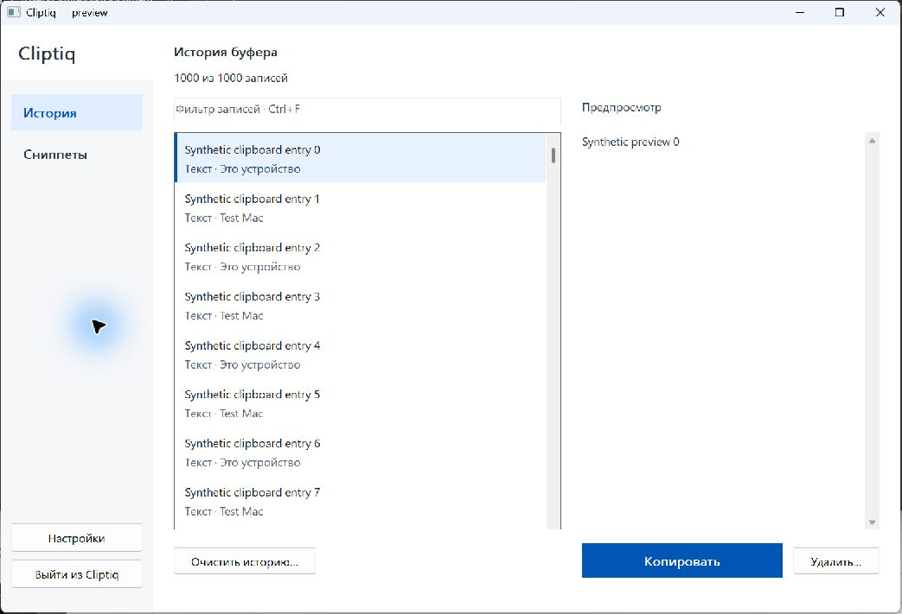

# Win32 history design and measurements — 2026-11-14

Before work, synchronized the clean checkout to origin feature/windows-workspace
839a915 (main contains only an initial commit). Work is on codex/history-design.

## Changes

- 64 DIP header instead of 96; brand reduced from 22 to 16 pt; list starts at
  124 DIP instead of 216; sidebar reduced from 190 to 176 DIP.
- Native virtual ListView, fixed 56 DIP two-line rows. Content gets full width;
  type/source move underneath. Stock selection, scrolling and accessible item
  text retained. Custom paint has no payload reads or decoding.
- Primary blue Copy; smaller secondary Delete and Clear actions. Ctrl+F cue.
- Only short display strings cached; full tooltip search conversion is transient.
  No animation timer, GUI runtime, per-row HWND or new background worker.
- Raven source, build option, comparison docs, dependency checkout, packages and
  local build removed. Generic Win32 counters moved to process_counters.py;
  measure.py and measure-running.py remain usable. Historical notes mentioning
  the old experiment or its exclusion remain historical evidence.

## Matched native benchmark

1000 identical synthetic rows, seven processes per variant in alternating order.
Both MSVC 19.51, x64 MinSizeRel, static CRT, IPO/LTO. Windows 11 build 26200.
Each process performs 30 timed filter operations and 60 selection/scroll
operations after warmup. Table gives the median across process-level statistics.
UI-thread dispatch plus explicit synchronous ListView paint is measured; this is
not first-pixel presentation, startup time, GPU time or a frame-rate measurement.
Filesystem/driver caches were not cleared. No builds/tests/preview UI ran alongside
the final benchmark. App profiles and clipboard payload are not used by this test.

| Operation | Before | After |
|---|---:|---:|
| Show workspace + paint, ms | 7.791 | 8.616 |
| Filter median, ms | 7.288 | 2.635 |
| Filter p95, ms | 10.929 | 6.522 |
| Select + scroll into view median, ms | 4.211 | 3.820 |
| Selection p95, ms | 8.319 | 6.129 |
| Page scroll + repaint median, ms | 1.111 | 1.652 |
| Page scroll p95, ms | 4.362 | 5.860 |

Filtering improved by 2.77x.
There is **not zero regression**: first-show dispatch costs an extra
0.824 ms and page scrolling
an extra 0.541 ms in this series.
The two-line treatment adds drawing work; there is no ongoing redraw loop.
Native harness private commit: 11.67 →
10.47 MiB. This is not the full application footprint.

## Full application idle

Three fresh profiles per variant, 1000 synthetic ~1 KiB captures per profile,
2-second settling and 15-second measurement for each scenario. The before runs
were taken during initial A/B measurements; after runs were repeated after removing
the payload-sized search cache. Earlier after runs are deliberately excluded.
All included after runs match the final executable SHA256 in hashes.json.
Both application builds disable LAN because pinned Mbed TLS is not available
locally. OCR/auto updates and capture payload retention are disabled; real
clipboard listener remains active. No real profile, clipboard writes or autostart
changes. The harness had no tray available and explicitly hid the fallback
launcher for startup_hidden in both versions; this is not proof of real tray
background startup. workspace_visible measures a stationary visible window.
CPU 100% means one logical core; 32 logical cores exist. CPU ticks and short
samples make these low values coarse; no statistically established CPU speedup
is claimed. Working set includes shared pages; private commit excludes GPU memory.

| Scenario / metric | Before | After |
|---|---:|---:|
| startup_hidden / cpu_percent_one_core | 0.104 | 0.208 |
| startup_hidden / working_set_mib | 20.730 | 20.730 |
| startup_hidden / private_mib | 9.055 | 9.086 |
| workspace_visible / cpu_percent_one_core | 0.208 | 0.104 |
| workspace_visible / working_set_mib | 38.973 | 39.109 |
| workspace_visible / private_mib | 14.277 | 14.438 |

The full application's visible-window memory has a small increase from the short
row-text cache; the standalone benchmark's memory saving does not imply a full-app
RAM saving. EXE size: 1,813,504 → 1,818,624 bytes (+5 KiB). Removing Raven does not
save resident RAM in the base app because it was never linked into the base build.

## Verification

Release build succeeds. Final affected checks: **8/8 passed** (history layout,
workspace, unified snippets, Unicode, popup owner, bounded menu idle wait and both
idle services). New checks cover minimum width, row height, Copy/Enter, filter,
accessible virtual text, type-to-select/misses, deselection and paint without
preview reads. Existing unified-snippets check also covers DPI font updates.
A synthetic-only preview was inspected on the interactive desktop.

Full suite: **51/63 passed**, not green. Eleven tests cannot create an isolated
WindowStation (Access denied 5), and the Authenticode positive fixture fails.
These same limitations are documented in ../windows-workspace-verification.md.
No tests were disabled. macOS/Linux were not built; no full screen-reader or
high-contrast/DPI hardware sweep is claimed. Independent review found keyboard
search and deselection cases; regression tests reproduced and verified their fixes.

## Reproduce

Build with experiments/windows-idle/build.ps1 -Tests -WithoutLan -Targets all.
Build target workspace_preview separately for synthetic-only interactive inspection.
Use compare-workspace.py --before <baseline workspace_benchmark.exe> --after
<new workspace_benchmark.exe> --output <json> --trials 7. Baseline uses the same
harness default path added to 839a915 before changing the product source. Binary
hashes, raw benchmark and all six full-app runs are in history-design/.
Use measure.py --build-dir <dir> --output <json> --entries 1000 --seconds 15
--settle 2 --workspace-visible --workspace for each full-app run.
